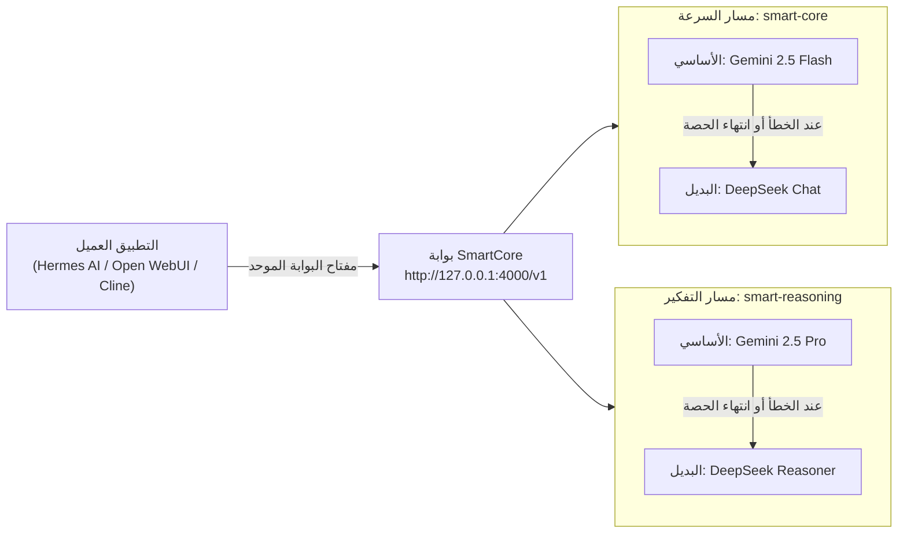

# SmartCore LLM Proxy

[](https://github.com/aaserag1/SmartCore-LLM-Proxy/actions/workflows/ci.yml)
[License: MIT](https://www.google.com/search?q=LICENSE)
[](https://www.python.org/)
[PRs Welcome](https://www.google.com/search?q=CONTRIBUTING.md)

بوابة محلية متوافقة مع OpenAI توحّد الوصول إلى نماذج الذكاء الاصطناعي عبر LiteLLM، وتعيد المحاولة عند الأخطاء المؤقتة، ثم تنتقل تلقائيًا من Gemini إلى DeepSeek من دون تغيير إعدادات التطبيق.

> [English documentation](README.md)

## مخطط عمل البوابة (Architecture)



## المميزات

- رابط OpenAI موحّد يعمل مع Hermes AI وOpen WebUI وإضافات البرمجة مثل Cline وContinue.dev والبرامج الخلفية.
- إعادة محاولات، مهلة زمنية ذكية (`timeout`)، وتحويل تلقائي عند امتلاء السياق أو تعطل المزود (`smart-core` للمهام السريعة و`smart-reasoning` للتفكير العميق).
- قراءة المفاتيح من متغيرات البيئة بدل تخزينها في `config.yaml`.
- تهيئة تلقائية لملف `.env` وتوليد مفتاح البوابة عبر `--init`، وأداة تشخيص مدمجة عبر `--doctor`.
- حماية البوابة بمفتاح رئيسي وربطها بالجهاز المحلي افتراضيًا.
- تشغيل على Windows وmacOS وLinux أو Docker Compose مع توحيد إصدار LiteLLM تلقائياً.
- فحص تلقائي للإعدادات واختبارات شاملة عبر GitHub Actions.

المشروع يحسن الاستمرارية لكنه لا يضمن عمل الخدمة بنسبة 100%، لأن التوفر يعتمد أيضًا على الشبكة وحسابات المزودين وحدود الاستخدام.

## تشغيل سريع

### 1. التثبيت

```bash
git clone https://github.com/aaserag1/SmartCore-LLM-Proxy.git
cd SmartCore-LLM-Proxy
python -m venv .venv
```

فعّل البيئة:

```powershell
# Windows PowerShell
.\.venv\Scripts\Activate.ps1
```

```bash
# macOS / Linux
source .venv/bin/activate
```

ثم ثبّت الإصدار المحدد من LiteLLM:

```bash
python -m pip install --upgrade pip
python -m pip install -r requirements.txt
```

### 2. إعداد المفاتيح

هيّئ ملف `.env` وولّد مفتاح `LITELLM_MASTER_KEY` تلقائياً بأمر واحد:

```bash
python scripts/start_proxy.py --init
```

ثم افتح ملف `.env` وأضف مفاتيح المزودين:

- `GEMINI_API_KEY`: مفتاح Google AI Studio.
- `DEEPSEEK_API_KEY`: مفتاح DeepSeek.
- `LITELLM_MASTER_KEY`: مفتاح البوابة الرئيسي (يتم توليده تلقائياً عند تشغيل `--init`).

لا ترفع ملف `.env` أو أي مفتاح حقيقي إلى GitHub.

### 3. الفحص والتشخيص والتشغيل

```bash
python scripts/start_proxy.py --check-only
python scripts/start_proxy.py --doctor
python scripts/start_proxy.py
```

وإذا كنت تملك مفتاح مزود واحد فقط حالياً، يمكنك التشغيل باستخدام:

```bash
python scripts/start_proxy.py --allow-partial-providers
```

على Windows يمكنك أيضًا تشغيل:

```powershell
.\Run_LiteLLM.bat
```

وعلى macOS أو Linux:

```bash
./run.sh
```

### 4. ربط Hermes AI أو Open WebUI أو Cline

| الإعداد | القيمة |
| --- | --- |
| Base URL | `http://127.0.0.1:4000/v1` |
| API key | قيمة `LITELLM_MASTER_KEY` |
| Model | `smart-core` (سريع) أو `smart-reasoning` (تفكير عميق) |

| اسم النموذج في البوابة | النموذج الأساسي | النموذج الاحتياطي (Fallback) | الاستخدام الأنسب |
| --- | --- | --- | --- |
| `smart-core` | `gemini/gemini-2.5-flash` | `deepseek/deepseek-chat` | المحادثات اليومية والبرمجة السريعة |
| `smart-reasoning` | `gemini/gemini-2.5-pro` | `deepseek/deepseek-reasoner` | التحليل المعقد والتفكير العميق |

## التشغيل عبر Docker

```bash
docker compose up -d
docker compose logs -f smartcore
```

للإيقاف:

```bash
docker compose down
```

## تخصيص النماذج والتشخيص

عدّل `config.yaml`، واجعل أي مفتاح سري مرجعًا بالشكل:

```yaml
api_key: os.environ/MY_PROVIDER_API_KEY
```

النماذج التي تحمل `model_name` نفسه تدخل في مجموعة موازنة تحميل واحدة. ويمكن وضع مجموعة مختلفة ضمن `router_settings.fallbacks` أو `router_settings.context_window_fallbacks` لتعمل كبديل.

بعد كل تعديل شغّل:

```bash
python scripts/check_config.py config.yaml
python scripts/doctor.py
```

للمساهمة اقرأ [CONTRIBUTING.md](https://www.google.com/search?q=CONTRIBUTING.md)، وللإبلاغ الأمني اقرأ [SECURITY.md](SECURITY.md).

## الترخيص

المشروع متاح تحت [رخصة MIT](https://www.google.com/search?q=LICENSE).

تطوير أحمد عادل (أبو عادل)، والمساهمات المجتمعية مرحب بها.
